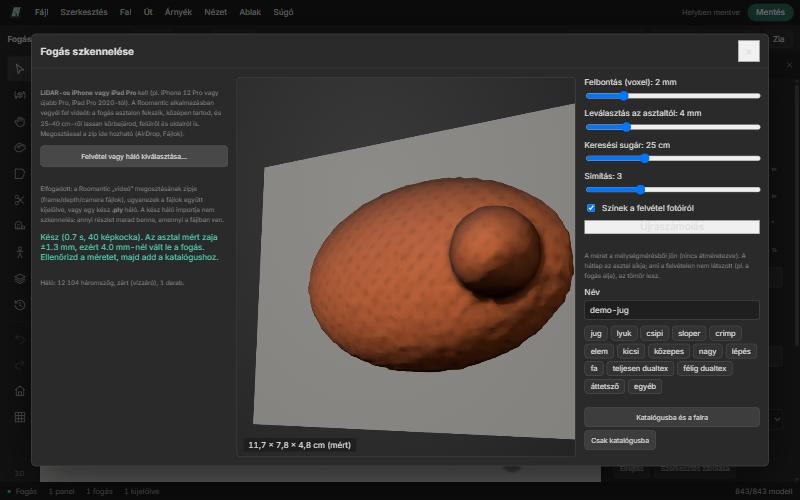
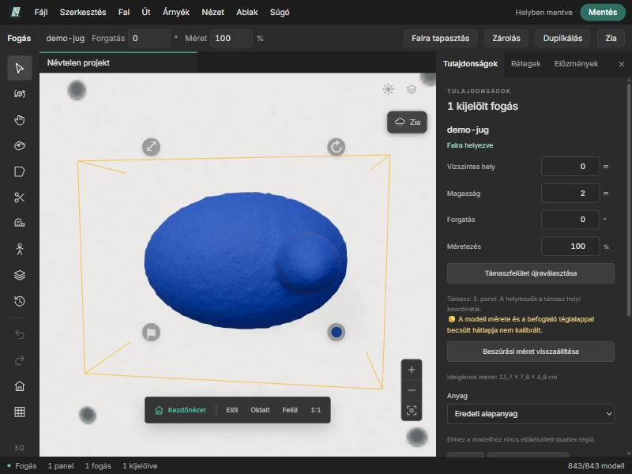
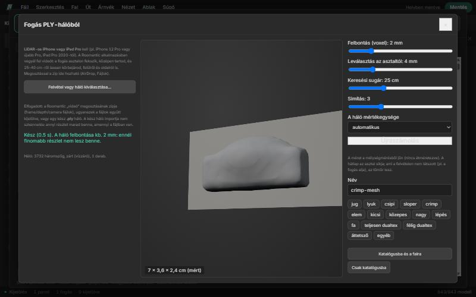
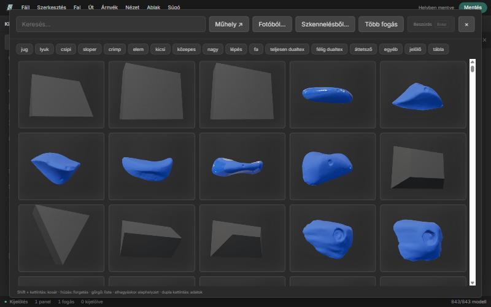

# Climbing Designer · Hold Scan

**From a LiDAR phone capture to a watertight, metric 3D climbing hold you can place on a wall.**

This repository is the public part of *Climbing Designer*, a 3D climbing-wall and route design app I build and use. The app itself is a local-first React + Three.js + Electron program with an offline iPad version; its interface is in Hungarian. The full app stays private because its hold catalogue contains commercially licensed models. This repository contains the **hold-scanning pipeline** added in release 1.3.0: the code, the benchmark, a synthetic demo capture and the tests. They run on their own with Node.js.

| Scan dialog (in the app) | Scanned hold on the wall after save + reopen |
|---|---|
|  |  |
| **PLY import (finished mesh, labelled as not a scan)** | **Hold catalogue of the full app (models not included here)** |
|  |  |

> The scan shown in the screenshots is the **synthetic demo capture** (`npm run demo`), not a real phone scan. See *Status and limitations*.

## How the capture is produced

1. **Capture.** A LiDAR iPhone or iPad Pro runs [Roomantic](https://github.com/Yuropa/Roomantic), an iOS app I co-authored with Yuropa and GlitchCraftStudio. Its "video" mode records, per frame:
   - an RGB frame;
   - ARKit `smoothedSceneDepth` (256×192, metres);
   - the camera intrinsics and pose.

   The shared zip is the input.
2. **Why not the app's own mesh?** Roomantic's on-device reconstruction is room-scale:
   - a 1 cm occupancy grid;
   - Gaussian-blurred hit counts;
   - marching cubes at iso = 1.

   On a 5–15 cm hold this inflates surfaces by centimetres or loses the object entirely (see the benchmark). The pipeline therefore re-fuses the **raw** depth.

## Pipeline (`src/domain/hold-scan.ts`)

1. **Look-at point:** least-squares intersection of all optical axes. The user keeps the hold centred.
2. **Support plane:** RANSAC plus least-squares refit on back-projected depth. The normal faces the cameras.
3. **Noise model:** RMS of the points just below the plane. It sets the separation cut (≥ 2.5σ) and the TSDF truncation (≥ 3σ).
4. **Footprint and principal axis:** the grid component rising above the plane, nearest the look-at point.
5. **Projective TSDF in plane coordinates, with space carving.** Voxels seen in front of a surface are empty. Voxels below the cut or outside the footprint are empty. Voxels never observed because they are occluded are treated as solid. This yields a closed body with a flat back, the way a hold is mounted.
6. **Marching cubes** with shared edge vertices, using the three.js tables. Then: largest component, back snapped to Z = 0, light Taubin smoothing.
7. **Mount convention:** metres, X = long axis, Z = off the wall, centred.
8. **Mesh report:** boundary and non-manifold edges, components, volume.
9. **Vertex colours:** taken from frames that see a vertex head-on and unoccluded (sRGB → linear).

**Finished meshes (`.ply`)** take the same route. The mesh is welded, the plane and footprint are found, and 48 virtual depth cameras render it with a software z-buffer. The renders are fused exactly like a capture, so open or dirty meshes come out watertight. The UI labels this **"import, not a scan"**.

`src/domain/scan-capture.ts` reads the capture format and PLY:
- the 12-byte depth-blob header plus float32 depth;
- column-major simd matrices;
- PLY in ASCII and binary little-endian, with Hungarian error messages.

The format conventions were verified on a real 105-frame Roomantic capture. Depth back-projected from different views agrees to a median of 2.5–10 mm. Reading the matrices transposed gives 18.5 mm, which is how the convention is confirmed.

## Benchmark (`npm run benchmark`)

Ground truth comes from three analytic holds:
- a sloper;
- a jug with an undercut;
- a crimp.

They are captured by a **simulated** LiDAR:
- 256×192 depth;
- Gaussian noise σ at 32 cm, growing with d²;
- 3×3 smoothing;
- optional per-frame pose drift.

Each method is compared to the truth by:
- symmetric surface distance using a kd-tree, clipped at 10 mm;
- F-score at 2 mm;
- bounding-size and volume error.

Full table: [`docs/benchmark.md`](docs/benchmark.md) (raw: `docs/benchmark.json`).

| Method | Mean surface error | F@2mm | Size error | Time / hold | Watertight |
|---|---|---|---|---|---|
| **TSDF (this repo)**, σ 1.5 mm, 48 frames | 0.5–0.65 mm | 0.94–0.98 | 0.1–4.6 mm | 0.15–0.4 s | always |
| TSDF, σ 4 mm noise | 0.8–1.1 mm | 0.81–0.92 | 1–9 mm | 0.2–0.3 s | always |
| TSDF, only 12 frames | 0.5–0.7 mm | 0.94–0.98 | ≤ 3 mm | ≈ 0.1 s | always |
| TSDF, 1 mm/frame pose drift | 0.5–0.75 mm | 0.90–0.96 | ≤ 4.3 mm | 0.15–0.3 s | always |
| Roomantic 1 cm occupancy → same cleanup | 4.9–9.1 mm, or **no object** in 7 of 12 runs | 0–0.32 | 26–428 mm | 0.1–0.7 s | – |
| Single-photo relief (app release 1.2.0) with **perfect depth and the true size given** | 1.1–3.7 mm | 0.49–0.74 | given | 0.3 s | – |

**Reading this honestly:**
- These are **synthetic** captures. Real ARKit depth on glossy resin, with hand motion, will be worse. The numbers are an upper bound and a regression guard, not a field result.
- Scanning is **not** always the better option. For a flat sloper, the single-photo relief (given oracle depth) comes close. It cannot represent undercuts, though: the jug's lip disappears. With a real photo, the size must also be typed in by hand.
- The sloper's thin, tapering rim falls under the 4 mm table cut, so it comes out 2–5 mm short. That is a real limitation of separating a hold from its support plane.

## Quick start

Requires Node.js ≥ 22.18 (TypeScript runs directly through Node's type stripping).

```bash
npm ci
npm test              # capture format, conventions, accuracy, watertightness, undercut, colours, PLY, Roomantic baseline
npm run demo          # writes demo-jug.zip (synthetic Roomantic-format capture) and scans it to demo-jug.ply
npm run benchmark     # prints the table above (about 1 minute)
npm run typecheck
```

To scan your own capture (a Roomantic "video" share zip or folder) or clean up a finished mesh:

```bash
node scripts/scan-cli.mjs capture.zip hold.ply           # LiDAR capture → TSDF fusion
node scripts/scan-cli.mjs mesh.ply hold.ply --unit mm    # finished mesh (import, not a scan)
```

The CLI prints the mesh report (size in mm, triangles, watertightness, measured table noise) and writes a binary PLY in metres. Colours need decoded photos, which only the app does.

The optional test `ROOMANTIC_SAMPLE=<Roomantic repo>/RoomanticLibTest/images npm test` runs the pipeline on Roomantic's real test capture.

## Repository layout

| Path | What |
|---|---|
| `src/domain/scan-capture.ts` | Roomantic capture and PLY readers/writers |
| `src/domain/hold-scan.ts` | Plane fit, footprint, TSDF fusion, marching cubes, PLY path, colours, mesh report |
| `src/domain/scan-synthetic.ts` | Analytic holds, LiDAR simulator, kd-tree mesh comparison |
| `src/domain/roomantic-occupancy.ts` | Re-expression of the Roomantic library reconstruction, used only as a baseline |
| `src/domain/photo-hold.ts` | Single-photo relief from the app's 1.2.0 release, used as a baseline |
| `scripts/scan-cli.mjs` · `scan-benchmark.mjs` · `make-demo-capture.mjs` | CLI, benchmark, demo capture |
| `tests/scan.test.mjs` | The test suite of the 1.3.0 scan feature |

## Status and limitations

- **Not yet tested on a real device.** Building the Roomantic iOS app needs a Mac with Xcode, and no real hold has been captured yet with an iPhone 12 Pro or newer Pro model, or an iPad Pro 2020 or newer. The capture *format* is verified against Roomantic's source and its real test capture; the *accuracy* is verified only in simulation.
- A browser camera gives no ARKit depth. The iPad web version of the app can load a capture but cannot record one.
- Anything the capture never saw (the hold's underside) is filled solid. The back is the table plane.
- In the full app, the scan goes end to end: scan dialog → catalogue → wall → save → reopen. That flow was verified in a browser with a separate data store. Its 342-test suite stays private with the app.

## Credits

- **Roomantic** (iOS capture app and its C++ reconstruction library): Yuropa, GlitchCraftStudio and Áron Bán-Szabó. `roomantic-occupancy.ts` re-expresses its reconstruction algorithm in TypeScript for comparison; no Swift or C++ code is copied. One camera file from its test capture appears verbatim as a test fixture.
- Marching-cubes edge and triangle tables: [three.js](https://threejs.org) (MIT), imported from `three/addons`.
- Built with help from AI coding assistants; design decisions, testing and evaluation are mine.
